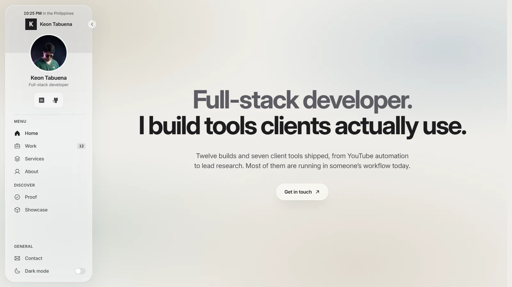

# Keon Tabuena, full-stack developer

Source for my developer portfolio at **https://chevykt.github.io/**.



## What it is

A Vite, React and TypeScript single-page site in a Liquid Glass theme: translucent panels over a soft wallpaper, Apple's system font on Apple devices and Inter everywhere else. It shows my client tools, GovRate (in development), my own tools and coursework, a pipeline diagram, and test-run receipts instead of testimonials.

## Run it

```bash
npm ci
npm run dev        # http://localhost:5190
npm run build      # type-checks, builds dist/, writes the sitemap
npm run preview    # serves dist/ on http://localhost:5191
```

## Checks

Each section has a Playwright check that drives it like a visitor (`npm run check:home`, `check:work-sheet`, `check:proof`, `check:contact` and the rest in `package.json`; set `BASE` to point them at another server). `npm run check:content` is the release gate: it fails on template leftovers, thin type, traction claims and, on my machine, client names from a local list that is never committed.

## Deploy

Every push to `main` builds the site with GitHub Actions and publishes it to GitHub Pages. `scripts/pages-routes.mjs` gives each route in the sitemap its own copy of the app shell, so deep links like `/work/client-tools` load directly.

## Credit and licence

Built on [portfoliov2-template](https://github.com/brewed-ops/portfoliov2-template) by brewed-ops, used under its licence for a personal portfolio. See [LICENSE](LICENSE).
